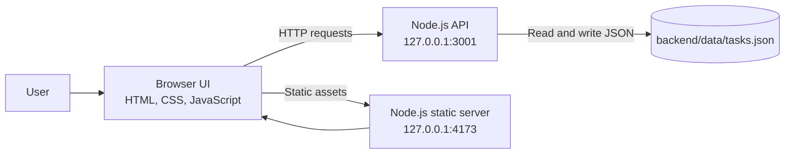
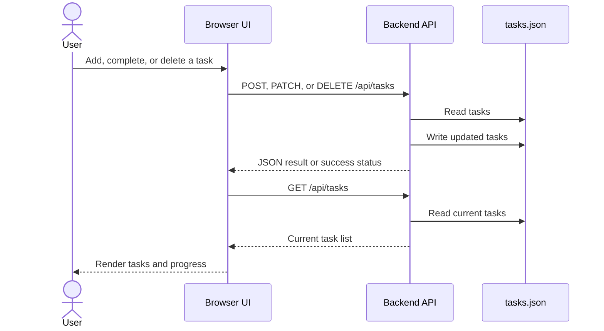

# Daybook documentation

Daybook is a small full-stack task manager. The browser interface lets a user
create tasks, mark them complete, and delete them. The backend exposes a JSON
API and stores tasks in `backend/data/tasks.json`.

## Application architecture



The frontend and API are separate Node.js processes. The frontend server only
serves static files; task operations go directly from the browser to the API.
The API permits browser requests from the local frontend origins on port 4173.

## Task operation flow



On page load, the UI requests the current task list. After a successful
mutation, it reloads the list so the task count and completion status stay in
sync with the saved data. Request errors are displayed in the status message
under the list.

## Implementation

### Frontend

- [index.html](frontend/index.html) defines the accessible task form, task
  list, progress label, and live status message.
- [styles.css](frontend/styles.css) styles the responsive Daybook interface,
  including small-screen layout and reduced-motion preferences.
- [app.js](frontend/app.js) loads tasks, renders task rows, submits task
  changes, and displays API errors. It uses `textContent` for task titles and
  encodes task IDs before placing them in request paths.

### Backend

- [server.mjs](backend/server.mjs) exposes the task API and serves requests
  from the local frontend origin.
- Task titles are trimmed and limited to 1–120 characters. Completion updates
  require a boolean value, and JSON request bodies are limited to 16 KiB.
- Tasks are assigned UUIDs and ISO creation timestamps, then persisted in
  [tasks.json](backend/data/tasks.json).
- The frontend static server in [server.mjs](frontend/server.mjs) serves the
  HTML, CSS, and JavaScript separately from the API.

### Implementation screenshot

The Daybook browser screenshot captured during this run shows the page heading
and task-entry form. The live page is available at
<http://127.0.0.1:4173>.

## Features and output

- Add a task with a title of 1–120 characters.
- Toggle a task between complete and incomplete.
- Delete a task.
- View the total task count and completion progress.
- Keep tasks across restarts using the JSON data file.
- Use the responsive interface on narrow and wide screens.

The browser output was checked at `http://127.0.0.1:4173` with the API running
at `http://127.0.0.1:3001`. At the time of capture, the app displayed three
completed tasks:

| Task | Status |
| --- | --- |
| dance | Complete |
| eating | Complete |
| read,sing,dance | Complete |

The live browser screenshot captured during verification is shown with this
change in the task conversation. The API response screenshot shows the three
saved task records in JSON.

## API reference

| Method | Endpoint | Request body | Result |
| --- | --- | --- | --- |
| `GET` | `/api/tasks` | — | `200` and the task array |
| `POST` | `/api/tasks` | `{ "title": "Plan the day" }` | `201` and the created task |
| `PATCH` | `/api/tasks/:id` | `{ "completed": true }` | `200` and the updated task |
| `DELETE` | `/api/tasks/:id` | — | `204` with no response body |

Invalid task titles and completion values return `400`. Requests for unknown
tasks or routes return `404`. The API returns JSON error details for failed
requests.

## Data format

Each saved task has the following shape:

```json
{
  "id": "generated-uuid",
  "title": "Plan the day",
  "completed": false,
  "createdAt": "2026-10-28T13:10:48.383Z"
}
```

The API reads and writes the full JSON array at `backend/data/tasks.json`.
New tasks are placed at the start of the array.

## Testing

The frontend returned HTTP `200` and rendered the task manager. The API
returned HTTP `200` with the three persisted tasks. A create/update/read/delete
check was then run against the API using a temporary task:

| Check | Expected result | Outcome |
| --- | --- | --- |
| `GET /api/tasks` | `200`, current task array | Passed |
| `POST /api/tasks` with a valid title | `201`, new incomplete task | Passed |
| `PATCH /api/tasks/:id` with `completed: true` | `200`, completed task | Passed |
| `GET /api/tasks` after update | `200`, updated task appears | Passed |
| `DELETE /api/tasks/:id` | `204`, no response body | Passed |
| Post-test cleanup | Original three tasks unchanged | Passed |

The test screenshot captured during verification shows the API's JSON response
in the browser. The browser and API screenshots are displayed in the task
conversation; no test task was left in persistent storage.

## Project layout

```text
backend/
  data/tasks.json   Persistent task data
  server.mjs        JSON API and file storage
  package.json      Backend start command
frontend/
  app.js            API requests and UI rendering
  index.html        Page structure
  server.mjs        Static-file server
  styles.css        Responsive styling
  package.json      Frontend start command
README.md           Quick-start instructions
DOCUMENTATION.md    Architecture, implementation, testing, and output details
```

## Run locally

Requires Node.js 18 or newer. No third-party package installation is needed.
Open two terminals in the project directory:

```powershell
cd backend
npm start
```

```powershell
cd frontend
npm start
```

Then open `http://127.0.0.1:4173`. The API listens at
`http://127.0.0.1:3001`.
